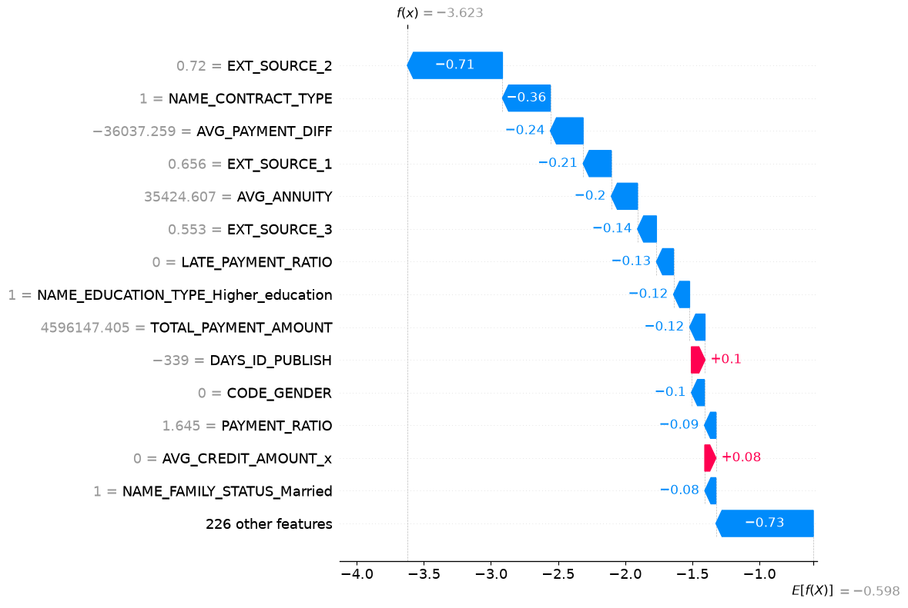

# Credit Default Risk Prediction

Predicting whether a loan applicant will default can help credit analysts identify applications that need closer review. This project explores that problem with **Home Credit customer and credit-history data**, compares five classification model families, and presents the selected **LightGBM** model through an explainable **Streamlit** application.

## Results at a glance

| Evidence | Verified result |
| --- | --- |
| Customer records | **307,511** labeled application records (307K+) |
| Features processed | **240 final model features**, including encoded variables and historical aggregates |
| Training / validation | **246,008 / 61,503** records |
| Selected model | **LightGBM with `scale_pos_weight`** |
| Validation ROC-AUC | **0.7833** (unrounded: 0.7833093104) |
| Decision threshold | **0.68**, selected through validation-set threshold analysis |

These are **validation results**, not an independent test-set score or measured business impact. The 240 features were processed for modeling; they are not 240 newly engineered indicators.

**Evidence:** [feature reconstruction checks](reports/preprocessing_parity.json), [historical model comparison](reports/model_comparison.md), [deployment notebook](notebooks/18_Preprocessing_Deployment.ipynb), and [final evaluation notebook](notebooks/17_Model_Evaluation.ipynb).

[Model comparison](reports/model_comparison.md) | [Notebook guide](notebooks/README.md) | [Run locally](#run-locally)

## From customer history to a risk score

1. **Understand and prepare the data.** Explore application records, bureau credit history, monthly bureau status, installments, previous applications, POS cash balances and credit-card activity. Clean missing values and anomalies, encode categorical variables, and combine application information with six customer-level aggregate tables.
2. **Compare classification models.** Explore Logistic Regression, Decision Tree, Random Forest, XGBoost and LightGBM. The notebooks include hyperparameter searches, class weighting and threshold analysis; the report distinguishes baseline, search-optimized and final weighted variants.
3. **Evaluate the selected model.** Assess ROC-AUC, KS, precision, recall, F1 and confusion matrices. At threshold **0.68**, the recorded LightGBM result has **27.90% default precision**, **41.85% default recall** and **0.3348 F1**. This exposes the trade-off between missed defaults and false alerts rather than relying on accuracy alone.
4. **Explain predictions with SHAP.** Inspect global feature importance and individual waterfall explanations to understand which variables increase or decrease the model output. SHAP explains model behavior, not causal effects.
5. **Present the results in Streamlit.** Provide a portfolio overview, individual customer analysis, and model-performance exploration with an adjustable threshold and prediction export.

### Example: explaining an individual prediction



*Existing SHAP output from the project, not a dashboard screenshot. Contributions are on the model-output scale, not percentage-point changes in default probability. No dashboard screenshot is currently included in this repository.*

## Model comparison

| Model / variant | Recorded validation ROC-AUC |
| --- | ---: |
| Logistic Regression, baseline without PCA | 0.7705 |
| Decision Tree, search optimized | 0.7042 |
| Random Forest, search optimized | 0.7664 |
| XGBoost, search optimized | 0.7769 |
| LightGBM, search optimized | 0.7819 |
| **LightGBM, final weighted variant** | **0.7833** |

These are historical saved outputs, not a fresh benchmark under a newly unified protocol. Three-fold cross-validation results are recorded for several searches in the [full comparison](reports/model_comparison.md). **An optimized Logistic Regression validation result is not recorded** in notebook 12. Random Forest and XGBoost tuning did not improve their recorded validation ROC-AUC over their respective baselines. The final weighted LightGBM is distinct from the randomized-search winner.

## Streamlit application

- **Overview:** validation population, observed defaults, score distribution, detected defaults and saved SHAP importance.
- **Customer analysis:** select a validation record, upload a complete prepared feature vector, or transform a raw application CSV using the historical preprocessing pipeline. Inspect the score, threshold classification and individual SHAP explanation.
- **Model performance:** compare historical results, simulate decision thresholds, inspect the confusion matrix and ROC curve, and export validation predictions.

Inputs are checked for feature presence, order, types and finite values. Incomplete prepared vectors are rejected rather than silently filled with validation medians. Weighted model scores are not established as calibrated default probabilities.

## Run locally

**Data prerequisite:** the GitHub repository includes code, notebooks, model artifacts and the frozen preprocessing specification. Raw/processed datasets and the large saved split are excluded. The application will not run from a fresh clone until its local data dependencies are restored.

| Purpose | Required local files |
| --- | --- |
| Open the application / select validation customers | `data/processed/xgb_split.pkl` |
| Display global SHAP importance | `data/processed/shap_feature_importance.csv` (optional chart) |
| Transform raw application CSVs | Six aggregate CSVs listed below |
| Download the raw application example | `data/raw/application_train.csv` |
| Re-export and verify preprocessing | Original application training CSV, aggregate CSVs and saved split |

The aggregate files, under `data/processed/`, are `bureau_features.csv`, `bureau_balance_features.csv`, `installments_features.csv`, `previous_application_features.csv`, `pos_cash_features.csv`, and `credit_card_features.csv`. Restore the original artifacts or reproduce the historical preparation in the [notebooks](notebooks/README.md); there is no automated raw-data download/build command included.

From the repository root, using a compatible Python environment:

```powershell
python -m pip install -r requirements-tested.txt
python -m streamlit run app/app.py
```

For the existing Windows workspace environment used for application checks:

```powershell
.\.venv-1\Scripts\python.exe -m streamlit run app/app.py
```

The Streamlit module command and application entry point were verified locally; the dashboard and performance page passed Streamlit execution checks with local data. `requirements-tested.txt` records observed direct dependency versions, not a complete lockfile or a newly tested clean installation. `requirements.txt` provides the unpinned direct dependency list. Saved pickle artifacts require compatible library versions.

## Reusable historical preprocessing

[`src/preprocessing.py`](src/preprocessing.py) reconstructs model inputs from raw application rows and the six existing aggregate tables, joined by `SK_ID_CURR`. Encodings, imputation values and constants are recovered from saved training rows and frozen for reuse; they are not recalculated from a new customer.

To regenerate the specification and verify feature parity, after restoring the required data:

```powershell
python src/export_preprocessing.py
```

The exporter writes `data/models/preprocessing.json` only after matching all **240 features** across **246,008 training** and **61,503 validation** records at numerical tolerance `1e-12`. See the [verification report](reports/preprocessing_parity.json). Unknown categories or unavailable historical imputations are rejected explicitly.

The pipeline reuses local historical aggregates; it does not fetch banking history or aggregate new transaction files automatically. Update those tables before scoring new customers whose history has changed.

## Repository guide

| Location | Contents |
| --- | --- |
| `app/` | Streamlit pages, shared predictions, input checks and raw-pipeline adapter |
| `src/` | Historical preprocessing, verified export and retraining script |
| `notebooks/` | Exploration, preparation, model experiments, evaluation and explainability |
| `data/models/` | Saved LightGBM model, feature schema, metadata and preprocessing specification |
| `reports/` | Historical model comparison and feature-parity evidence |
| `docs/` and root spreadsheets | Feature dictionaries and analysis documents |
| `data/raw/`, `data/selected/`, `data/processed/` | Local source and intermediate data, excluded from GitHub |

The [notebook guide](notebooks/README.md) explains each notebook's role. Historical code and outputs are preserved. Workbooks referenced by notebooks retain their paths; file movements are tracked in [the organization manifest](reports/organization_manifest.json). Some archival paths in that manifest refer to local-only working extracts.

## Scope and limitations

- Validation was used for model and threshold exploration. An untouched final test set is still needed for a stronger generalization claim.
- Identical validation counts across experiments do not prove identical row membership or preprocessing. The comparison report preserves this distinction.
- Reconstructing historical features proves parity with saved inputs, not absence of leakage in the original notebook preparation. A stricter future training pipeline should fit preprocessing inside training folds.
- The current saved schema contains `CODE_GENDER`. The separate `src/retrain_without_gender.py` script does not establish that the published model was trained without it. Fairness assessment remains necessary before operational use.
- Some anomaly indicators became constant during historical notebook execution; reconstruction preserves that behavior for model compatibility. Fixing the original preparation requires retraining and renewed evaluation.

**Stack:** Python, pandas, NumPy, scikit-learn, XGBoost, LightGBM, SHAP, matplotlib and Streamlit.
